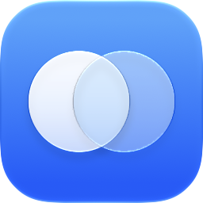

<div align="center">



# MySelf: a personal productivity app for macOS

**One native Mac app for your to-dos, notes, university classes, office tasks, interview prep and product boards. Built with SwiftUI and synced over iCloud Drive.**

[](#requirements)
[](https://www.swift.org)
[](https://developer.apple.com/xcode/swiftui/)
[](#requirements)
[](LICENSE)
[](https://github.com/Ok9xNirab/myself/commits/main)

[**⬇ Download the DMG**](https://github.com/Ok9xNirab/myself/releases/latest) · [Features](#features) · [Install](#installation) · [Build from source](#build-from-source) · [iCloud sync](#icloud-sync)


</div>

## Why MySelf?

Most people track their life across five apps: a todo list, a notes app, a Kanban board, a study tracker and a calendar for classes. **MySelf puts all of them in one fast, native macOS window**, with a dashboard that shows what's due today across everything.

- 🖥️ **Native Mac app**: SwiftUI with a real sidebar, toolbar, menus, multiple windows and keyboard shortcuts. Not a web wrapper.
- 🔒 **Your data stays yours**: no account, no server, no tracking. Every item is a small JSON file in a folder you choose.
- ☁️ **Free iCloud sync**: syncs between your Macs through iCloud Drive.
- ⌨️ **Keyboard-first**: Quick Open (<kbd>⌘K</kbd>), a system-wide search shortcut (<kbd>⌥⌘K</kbd>) and a shortcut for every page.
- 🧩 **Only what you use**: switch off any section you don't need and it disappears everywhere.

## Features

| Section | What it does |
| --- | --- |
| 📊 **Dashboard** | *Today's focus* (todos and office tasks due today or overdue, plus assignments due by tomorrow), classes today, deadline countdown, syllabus progress and product activity. |
| ✅ **TODOs** | Tasks with priorities, colour labels and due dates ("Today", "Tomorrow", "2d overdue"). |
| 🎓 **University** | Classes with a weekly schedule, syllabus subjects and topics, assignments and exams. |
| 💼 **Office Tasks** | Work tasks with notes, a reference link and a due date. Always high priority. |
| 📖 **Job Study** | Interview-prep subjects with a revision checklist. A topic is due again 7 days after you last revised it, and topics can link to notes. |
| 📝 **Notes** | A block editor with headings, lists, checklists, quotes, syntax-highlighted code, **LaTeX math**, **tables**, **images** (paste, drop or pick one; click to zoom) and Bengali set in the system's SF Bangla. Paste markdown and it becomes blocks. Select blocks like in Notion (<kbd>Esc</kbd>, <kbd>⌘A</kbd> twice, drag or Shift-click) and delete them with undo. **Reader mode** (<kbd>⇧⌘R</kbd>) locks a note and shows it as one page you can select and copy across. Notes are sorted into categories, and any note can open in its own window. |
| 🗂️ **Product Dev** | Kanban boards per project with Backlog, In Progress, Review and Done columns. Drag cards between columns, and tag them with Product Dev's own labels, kept separate from your TODO labels. |
| 🏋️ **Workout** | Week-by-week training programs. *Coming soon.* |

### Built for speed

- **Quick Open** (<kbd>⌘K</kbd>) jumps to any page, task or note.
- **Search MySelf from any app** (<kbd>⌥⌘K</kbd>, changeable) opens a Spotlight-style panel over whatever you're doing. No Accessibility permission needed.
- **Menu bar icon** for quick access: New Todo, New Office Task, New Note, Search and Go To.
- **Shortcuts**: <kbd>⌘N</kbd> new todo, <kbd>⇧⌘N</kbd> new office task, <kbd>⌥⌘N</kbd> new note, <kbd>⌘1</kbd>–<kbd>⌘8</kbd> switch pages, <kbd>⌘[</kbd> / <kbd>⌘]</kbd> back and forward, <kbd>⇧⌘R</kbd> reader mode for a note, <kbd>⌃⌘S</kbd> show or hide the sidebar.
- **Looks at home on macOS**: light and dark mode, your system accent colour, sidebar style and row density options, and an adaptive app icon with dark, clear and tinted variants.

## Requirements

- **macOS 26 (Tahoe)** or later
- Apple Silicon or Intel (universal binary)
- To build from source: **Xcode 26** or later

The project also builds for iPadOS, iOS and visionOS, but macOS is the main platform.

## Installation

1. Download **`MySelf-<version>.dmg`** from the [latest release](https://github.com/Ok9xNirab/myself/releases/latest).
2. Open the DMG and drag **Myself** onto the **Applications** folder.
3. Open MySelf from Applications. The first time, macOS will block it. Follow [Opening MySelf for the first time](#opening-myself-for-the-first-time).

### Opening MySelf for the first time

MySelf is free and open source, and it isn't notarized by Apple (that needs a paid developer account). So the first time you open it, macOS shows:

> "Myself" Not Opened. Apple could not verify "Myself" is free of malware that may harm your Mac or compromise your privacy.

The app isn't damaged, and you can read every line of its source here. Allow it once:

1. Click **Done** on the warning (not *Move to Trash*).
2. Open **System Settings › Privacy & Security**.
3. Scroll down to **Security**, find *"Myself" was blocked…* and click **Open Anyway**.
4. Confirm with your password or Touch ID, then click **Open Anyway** again.

> [!TIP]
> On macOS 15 and later, Control-clicking the app and choosing **Open** no longer gets past this warning. Use **Open Anyway** in System Settings.

**Prefer Terminal?** Remove the download quarantine flag instead:

```sh
xattr -dr com.apple.quarantine /Applications/Myself.app
```

The same command fixes the *"Myself is damaged and can't be opened"* message.

### Updating and uninstalling

- **Update**: MySelf checks GitHub for a new release once a day (Settings › General › Updates, or **MySelf › Check for Updates…**) and links the DMG. Quit MySelf, drag the new version from the DMG into Applications and replace the old one. You may need to allow it once more. If MySelf then says it can't open your sync folder, choose the same folder again in Settings › iCloud.
- **Uninstall**: move `Myself.app` to the Trash. To also delete its local data, run `rm -rf ~/Library/Containers/com.ok9xnirab.myself`. Anything in your iCloud sync folder stays there until you delete it.

## iCloud sync

MySelf syncs through **a folder in iCloud Drive** instead of CloudKit, so it works without an Apple developer account.

1. Open **Settings › iCloud** and choose or create a folder, such as *iCloud Drive › MySelf*.
2. Pick the same folder on each of your Macs.

Each todo, label, office task, note, class, assignment, exam, study subject, board and card is saved as its own JSON file, and iCloud Drive copies them between Macs. If the same item was changed on two Macs, the newer change wins. With sync off, the same files live in the app's local Application Support folder.

Sync works between Macs only. The iPhone and iPad builds keep their data on the device.

> [!NOTE]
> MySelf is in active development. TODOs, Office Tasks, Notes, University, Job Study and Product Dev are saved and synced. Workout still uses sample data and doesn't save yet.

## Build from source

```sh
git clone https://github.com/Ok9xNirab/myself.git
cd myself
open Myself.xcodeproj
```

In Xcode, choose the **Myself** scheme and **My Mac**, then press <kbd>⌘R</kbd>. Xcode fetches the one dependency, [SwiftMath](https://github.com/mgriebling/SwiftMath), automatically.

### Make a distributable DMG

```sh
./scripts/make-dmg.sh
```

The script builds a universal Release app, ad-hoc signs it with hardened runtime and writes `dist/MySelf-<version>.dmg`, with the version read from `MARKETING_VERSION`. Upload that file to a [new GitHub release](https://github.com/Ok9xNirab/myself/releases/new).

If `xcodebuild` says it needs Xcode while only the Command Line Tools are selected, run `sudo xcode-select -s /Applications/Xcode.app/Contents/Developer`, or set `DEVELOPER_DIR` to that path.

## Project structure

```
Myself/
├── MyApp.swift          App entry point, scenes, menu commands
├── ContentView.swift    Sidebar, toolbar and page switching
├── Models/              AppStore (state and mutations), models, sync engine
├── Pages/               One view per section, plus Quick Open and Settings
├── Components/          Shared design-system views (cards, badges, progress…)
├── Support/             Dates, theme palette, preferences, markdown & code rendering
└── AppIcon.icon/        Icon Composer app icon
scripts/make-dmg.sh      Builds the release DMG
```

## Roadmap

- [x] TODOs, labels and Office Tasks, saved and synced
- [x] Notes with a block editor, LaTeX math and code highlighting
- [x] University, Job Study and Product Dev boards, saved and synced
- [x] System-wide search shortcut and menu bar icon
- [x] Images, reader mode and block selection in Notes
- [x] Update check against GitHub releases
- [x] Tables in Notes
- [ ] Workout programs, saved and synced
- [ ] Developer ID signing and notarization

## Contributing

Bug reports, feature ideas and pull requests are welcome. For bigger changes, please [open an issue](https://github.com/Ok9xNirab/myself/issues) first so we can talk it through.

If MySelf is useful to you, a ⭐ on GitHub helps other people find it.

## License

MySelf is released under the [MIT License](LICENSE).
