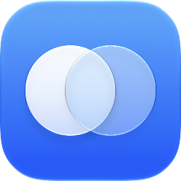
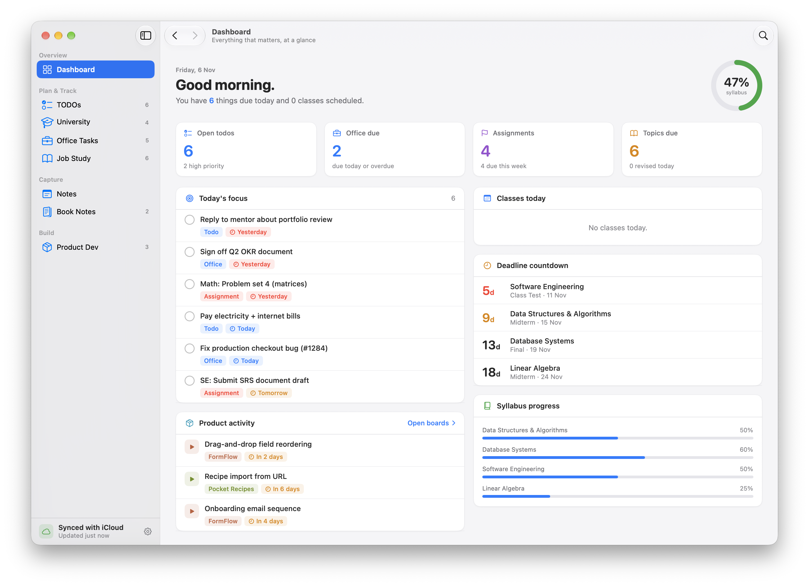

<div align="center">



# MySelf: a personal productivity app for macOS

**One native Mac app for your to-dos, notes, university classes, office tasks, interview prep and product boards. Built with SwiftUI and SwiftData, synced through iCloud.**

[](#requirements)
[](https://www.swift.org)
[](https://developer.apple.com/xcode/swiftui/)
[](#requirements)
[](LICENSE)
[](https://github.com/Ok9xNirab/myself/commits/main)

[**⬇ Download the DMG**](https://github.com/Ok9xNirab/myself/releases/latest) · [Features](#features) · [Install](#installation) · [Build from source](#build-from-source) · [iCloud sync](#icloud-sync)



</div>

## Why MySelf?

Most people track their life across five apps: a todo list, a notes app, a Kanban board, a study tracker and a calendar for classes. **MySelf puts all of them in one fast, native macOS window**, with a dashboard that shows what's due today across everything.

- 🖥️ **Native Mac app**: SwiftUI with a real sidebar, toolbar, menus, multiple windows and keyboard shortcuts. Not a web wrapper.
- 🔒 **Your data stays yours**: no sign-up, no MySelf server, no tracking. Everything lives on your devices and in your own iCloud account.
- ☁️ **Free iCloud sync**: syncs between your devices through your iCloud account (CloudKit).
- ⌨️ **Keyboard-first**: Quick Open (<kbd>⌘K</kbd>), a system-wide search shortcut (<kbd>⌥⌘K</kbd>) and a shortcut for every page.
- 🧩 **Only what you use**: switch off any section you don't need and it disappears everywhere.

## Features

| Section | What it does |
| --- | --- |
| 📊 **Dashboard** | *Today's focus* (todos and office tasks due today or overdue, plus assignments due by tomorrow), classes today, deadline countdown, syllabus progress and product activity. |
| ✅ **TODOs** | Tasks with priorities, colour labels and due dates ("Today", "Tomorrow", "2d overdue"). |
| 🎓 **University** | Classes with a weekly schedule, syllabus subjects and topics, assignments and exams. |
| 💼 **Office Tasks** | Work tasks with notes, a reference link and a due date. Always high priority. |
| 📖 **Job Study** | Interview-prep subjects with a revision checklist. A topic is due again 7 days after you last revised it, and topics can link to notes. |
| 📝 **Notes** | A block editor with headings, lists, checklists, quotes, syntax-highlighted code, **LaTeX math**, **tables**, **images** (paste, drop or pick one; click to zoom) and Bengali set in the system's SF Bangla. Paste markdown and it becomes blocks. Select blocks like in Notion (<kbd>Esc</kbd>, <kbd>⌘A</kbd> twice, drag or Shift-click) and delete them with undo. **Reader mode** (<kbd>⇧⌘R</kbd>) locks a note and shows it as one page you can select and copy across. Notes are sorted into categories, and any note can open in its own window. |
| 🗂️ **Product Dev** | Kanban boards per project with Backlog, In Progress, Review and Done columns. Drag cards between columns, and tag them with Product Dev's own labels, kept separate from your TODO labels. |
| 🏋️ **Workout** | Week-by-week training programs. *Coming soon.* |

### Built for speed

- **Quick Open** (<kbd>⌘K</kbd>) jumps to any page, task or note.
- **Search MySelf from any app** (<kbd>⌥⌘K</kbd>, changeable) opens a Spotlight-style panel over whatever you're doing. No Accessibility permission needed.
- **Menu bar icon** for quick access: New Todo, New Office Task, New Note, Search and Go To.
- **Shortcuts**: <kbd>⌘N</kbd> new todo, <kbd>⇧⌘N</kbd> new office task, <kbd>⌥⌘N</kbd> new note, <kbd>⌘1</kbd>–<kbd>⌘8</kbd> switch pages, <kbd>⌘[</kbd> / <kbd>⌘]</kbd> back and forward, <kbd>⇧⌘R</kbd> reader mode for a note, <kbd>⌃⌘S</kbd> show or hide the sidebar.
- **Looks at home on macOS**: light and dark mode, your system accent colour, sidebar style and row density options, and an adaptive app icon with dark, clear and tinted variants.

## Requirements

- **macOS 26 (Tahoe)** or later
- Apple Silicon or Intel (universal binary)
- To build from source: **Xcode 26** or later

The project also builds for iPadOS, iOS and visionOS, but macOS is the main platform.

## Installation

1. Download **`MySelf-<version>.dmg`** from the [latest release](https://github.com/Ok9xNirab/myself/releases/latest).
2. Open the DMG and drag **Myself** onto the **Applications** folder.
3. Open MySelf from Applications. The DMG is signed and notarized by Apple, so it opens without a warning.

### Updating and uninstalling

- **Update**: MySelf checks GitHub for a new release once a day (Settings › General › Updates, or **MySelf › Check for Updates…**) and links the DMG. Quit MySelf, drag the new version from the DMG into Applications and replace the old one.
- **Uninstall**: move `Myself.app` to the Trash. To also delete its local data, run `rm -rf ~/Library/Containers/com.quorrelapps.myself` (and `com.ok9xnirab.myself` if you used version 1.3.1 or earlier). Synced data stays in your iCloud account until you delete it in System Settings › Apple Account › iCloud › Manage storage.

## iCloud sync

MySelf keeps its data in a SwiftData store on each device and syncs it through **your private iCloud database** (CloudKit), so every device signed in to the same Apple Account sees the same todos, notes, classes and boards. It's on by default; turn it off in **Settings › iCloud**. Appearance and feature visibility can sync too.

There's nothing to set up: no folder to pick. If the same item was changed on two devices, the newer change wins. Your data counts towards your own iCloud storage, and nobody else, including the developer, can read it.

**Coming from an earlier version?** Versions up to 1.3.1 synced through a folder in iCloud Drive. Open **Settings › iCloud › Import a sync folder** and choose that folder (for example *iCloud Drive › MySelf*) to bring its data in. Data that stayed on the Mac is imported automatically, and **Settings › General › Import from an earlier MySelf** reads data from the old `com.ok9xnirab.myself` app. The old files are never changed.

> [!NOTE]
> MySelf is in active development. TODOs, Office Tasks, Notes, University, Job Study and Product Dev are saved and synced. Workout still uses sample data and doesn't save yet.

## Build from source

```sh
git clone https://github.com/Ok9xNirab/myself.git
cd myself
open Myself.xcodeproj
```

In Xcode, choose the **Myself** scheme and **My Mac**, then press <kbd>⌘R</kbd>. Xcode fetches the one dependency, [SwiftMath](https://github.com/mgriebling/SwiftMath), automatically.

### Make a distributable DMG

```sh
./scripts/make-dmg.sh
```

The script archives a universal Release app, signs it with a Developer ID certificate, writes `dist/MySelf-<version>.dmg` (the version comes from `MARKETING_VERSION`), then notarizes and staples it. It needs a Developer ID Application certificate and a `myself-notary` notary profile; the setup is at the top of the script. Upload that file to a [new GitHub release](https://github.com/Ok9xNirab/myself/releases/new).

If `xcodebuild` says it needs Xcode while only the Command Line Tools are selected, run `sudo xcode-select -s /Applications/Xcode.app/Contents/Developer`, or set `DEVELOPER_DIR` to that path.

## Project structure

```
Myself/
├── MyApp.swift          App entry point, scenes, menu commands
├── ContentView.swift    Sidebar, toolbar and page switching
├── Models/              AppStore (state and mutations), models, SwiftData schema, CloudKit sync
├── Pages/               One view per section, plus Quick Open and Settings
├── Components/          Shared design-system views (cards, badges, progress…)
├── Support/             Dates, theme palette, preferences, markdown & code rendering
└── AppIcon.icon/        Icon Composer app icon
scripts/make-dmg.sh      Builds the release DMG
```

## Roadmap

- [x] TODOs, labels and Office Tasks, saved and synced
- [x] Notes with a block editor, LaTeX math and code highlighting
- [x] University, Job Study and Product Dev boards, saved and synced
- [x] System-wide search shortcut and menu bar icon
- [x] Images, reader mode and block selection in Notes
- [x] Update check against GitHub releases
- [x] Tables in Notes
- [x] Developer ID signing and notarization
- [ ] Workout programs, saved and synced

## Contributing

Bug reports, feature ideas and pull requests are welcome. For bigger changes, please [open an issue](https://github.com/Ok9xNirab/myself/issues) first so we can talk it through.

If MySelf is useful to you, a ⭐ on GitHub helps other people find it.

## License

MySelf is released under the [MIT License](LICENSE).
