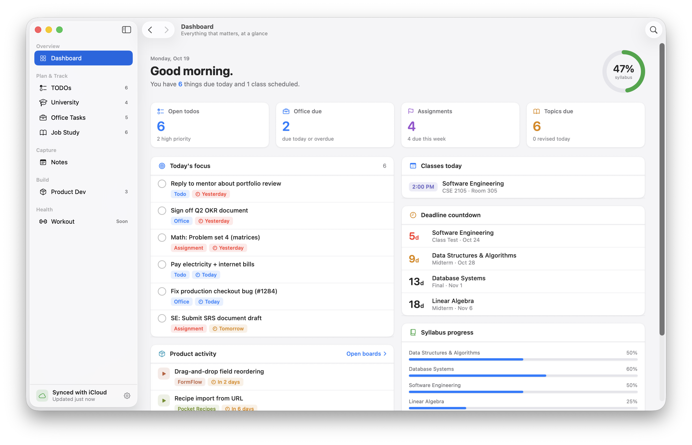

# MySelf

A personal OS for macOS, built in SwiftUI. One window for the things you track day to day: TODOs, university classes and assignments, office tasks, job-interview study, product boards and workout programs.



> [!NOTE]
> MySelf is in early development. **TODOs are saved and can sync between your Macs through iCloud Drive.** The other sections still run on sample data held in memory, so changes there are lost when you quit. Some editor sheets (such as "Add class") are placeholders for now.

## Features

| Section | What it does |
| --- | --- |
| **Dashboard** | Today's focus (todos and office tasks due today or overdue, plus assignments due by tomorrow) and summary tiles for every enabled section. |
| **TODOs** | Tasks with priorities, labels and due dates ("Today", "Tomorrow", "2d overdue"). Add with ⌘N, edit with a double-click, undo with ⌘Z. Saved and synced. |
| **University** | Classes, weekly schedule, syllabus progress, assignments and exams. |
| **Office Tasks** | Work tasks. These are always high priority. |
| **Job Study** | Interview topics with revision tracking. Ticking a topic logs a revision for today. |
| **Product Dev** | Kanban boards with Backlog, In Progress, Review and Done columns. |
| **Workout** | Week-by-week programs. Future weeks unlock as you finish the current one. |

Also included:

- **Quick Open** (<kbd>⌘K</kbd>) to jump to any page or item.
- Keyboard navigation: <kbd>⌘1</kbd>–<kbd>⌘7</kbd> go to a section, and <kbd>⌘[</kbd> / <kbd>⌘]</kbd> go back and forward.
- Light and dark mode, a choice of accent colours, sidebar style and row density.
- **Settings › Features**: switch off any section you don't use (University, Office Tasks, Job Study, Product Dev, Workout). It disappears from the sidebar, dashboard, Quick Open and Go menu, and its data stays in place.
- An adaptive app icon with dark, clear and tinted variants.

## Requirements

- **macOS 26 (Tahoe)** or later, on Apple Silicon or Intel.
- To build from source: **Xcode 26** or later.

The project also targets iOS, iPadOS and visionOS, but macOS is the primary platform and the only one covered below.

## Installation

MySelf isn't distributed through the Mac App Store and isn't notarized by Apple, so macOS Gatekeeper blocks it the first time you open it. The steps below show how to allow it. You only need to do this once.

### Option 1: Download a release

1. Go to the [Releases](https://github.com/Ok9xNirab/myself/releases) page and download the latest `MySelf.zip`.
2. Double-click the zip to extract `Myself.app`.
3. Drag `Myself.app` into your **Applications** folder.
4. Open it, then follow [Getting past Gatekeeper](#getting-past-gatekeeper).

### Option 2: Build from source

```sh
git clone https://github.com/Ok9xNirab/myself.git
cd myself
open Myself.xcodeproj
```

In Xcode, choose the **Myself** scheme and **My Mac** as the destination, then press <kbd>⌘R</kbd>.

To build from the command line instead:

```sh
xcodebuild -project Myself.xcodeproj -scheme Myself \
  -configuration Release -destination 'platform=macOS' \
  -derivedDataPath build \
  CODE_SIGN_IDENTITY=- CODE_SIGNING_REQUIRED=NO

cp -R build/Build/Products/Release/Myself.app /Applications/
```

If `xcodebuild` reports that it requires Xcode while only the Command Line Tools are selected, either run `sudo xcode-select -s /Applications/Xcode.app/Contents/Developer` or put `DEVELOPER_DIR=/Applications/Xcode.app/Contents/Developer` in front of the command.

An app you build on your own Mac isn't quarantined, so Gatekeeper normally won't block it.

## Getting past Gatekeeper

When you first open a downloaded copy, macOS shows a message such as:

> "Myself" Not Opened. Apple could not verify "Myself" is free of malware that may harm your Mac or compromise your privacy.

This happens because the app isn't signed with a paid Apple Developer ID. It doesn't mean the app is damaged. You can read every line of the source in this repository. Use either method below.

### Method A: System Settings (recommended)

1. Try to open **Myself** from Applications. When the warning appears, click **Done** (not *Move to Trash*).
2. Open **System Settings › Privacy & Security**.
3. Scroll down to the **Security** section. You'll see *"Myself" was blocked to protect your Mac.* Click **Open Anyway**.
4. Enter your password or use Touch ID when prompted.
5. Click **Open Anyway** once more in the dialog that follows.

From then on, MySelf opens normally.

> [!TIP]
> On macOS 15 and later, the old trick of Control-clicking the app and choosing **Open** no longer bypasses Gatekeeper. Use **Open Anyway** in System Settings instead.

### Method B: Terminal

Remove the quarantine flag that macOS adds to downloaded files:

```sh
xattr -dr com.apple.quarantine /Applications/Myself.app
```

Then open the app as usual.

### "Myself is damaged and can't be opened"

macOS sometimes shows this message for unsigned apps that were downloaded from the internet. The app isn't actually damaged. Run the `xattr` command from Method B, then open the app again.

If it still won't open, give it an ad-hoc signature and try again:

```sh
codesign --force --deep --sign - /Applications/Myself.app
```

## Updating

Download the new release, quit MySelf, and replace the old `Myself.app` in Applications with the new one. You may need to repeat [Getting past Gatekeeper](#getting-past-gatekeeper) for each new version.

## Uninstalling

1. Drag `Myself.app` from Applications to the Trash.
2. Optionally, remove its saved settings:

   ```sh
   rm -rf ~/Library/Containers/*Myself*
   ```

## Publishing a release (for maintainers)

Apple Silicon Macs won't launch a binary that has no signature at all, so a release must be at least ad-hoc signed:

```sh
xcodebuild -project Myself.xcodeproj -scheme Myself \
  -configuration Release -destination 'platform=macOS' \
  -derivedDataPath build \
  CODE_SIGN_IDENTITY=- CODE_SIGNING_REQUIRED=NO

cd build/Build/Products/Release
codesign --verify --verbose Myself.app
ditto -c -k --keepParent Myself.app MySelf.zip
```

Attach `MySelf.zip` to a new [GitHub release](https://github.com/Ok9xNirab/myself/releases/new). Use `ditto` rather than `zip`, because `ditto` preserves the app bundle's signature and extended attributes.

## Project structure

```
Myself/
├── MyApp.swift          App entry point, menu commands, settings window
├── ContentView.swift    Sidebar, toolbar and page switching
├── Models/              AppStore (state and mutations), models, sample data
├── Pages/               One view per section, plus Quick Open and Settings
├── Components/          Shared design-system views (cards, badges, progress…)
├── Support/             Date helpers, theme palette, preferences
└── AppIcon.icon/        Icon Composer app icon
```

## iCloud sync

MySelf syncs through a folder in iCloud Drive rather than CloudKit, so it works without a paid Apple Developer account. Open Settings › iCloud, choose (or create) a folder such as **iCloud Drive › MySelf**, and choose the same folder on each Mac. Each todo and label is saved there as its own small JSON file, and iCloud Drive copies the files between Macs. With sync off, the files live in the app's Application Support folder instead.

This works between Macs only. iPhone and iPad builds keep their data on the device.

## Roadmap

- Save and sync the other sections the same way TODOs are
- Working editors for the remaining sections

## Contributing

Issues and pull requests are welcome. For larger changes, please open an issue first to discuss what you'd like to change.
